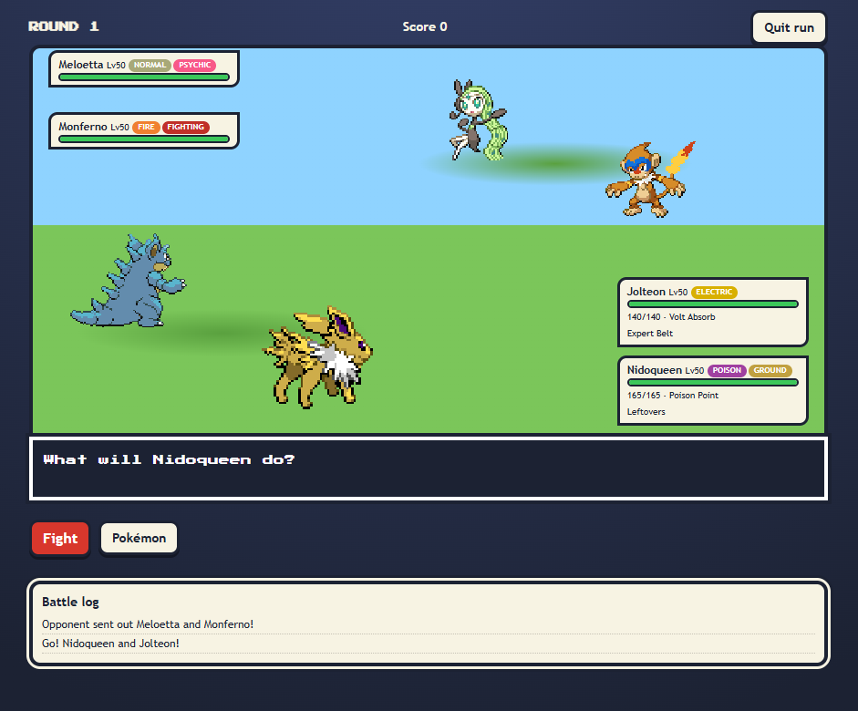

# Poke Doublerush

A browser based Pokémon roguelike featuring fast paced **Double Battles**, randomly generated teams, and iconic Pokémon battle gimmicks.
Random team, adapt your strategy, defeat your opponents, and see how many rounds you can survive!

<h2 align="center">
  <a href="https://isthisalif.github.io/Poke-Doublerush/">
    <strong>PLAY POKE DOUBLERUSH</strong>
  </a>
</h2>

<p align="center">   
   
</p>
<p align="center">
  
</p>

## About the Game

Poke Doublerush is a Pokémon inspired roguelike game built with HTML, CSS, and JavaScript. It combines traditional Pokémon battle mechanics with a round based progression system.

Every run offers a different experience. Pokémon, movesets, abilities, and held items are randomly generated, requiring players to adapt their strategies and make the best use of their available team.

**The objective is simple: Learn your team, defeat your opponents, and survive as many rounds as possible!**

## Features

- **Random Pokémon Generation** – Encounter randomly generated Pokémon using data from PokéAPI.
- **Team Selection** – Receive 6 Pokémon and select 4 to form your battle team.
- **Double Battles** – Battle with 2 active Pokémon against 2 opponents simultaneously.
- **Random Movesets** – Pokémon receive randomly generated movesets.
- **Random Abilities** – Each Pokémon receives a randomly assigned ability.
- **Held Items** – Pokémon can receive different held items to influence battle strategies.
- **Battle Gimmicks** – Includes Mega Evolution, Z-Moves, Dynamax, Gigantamax, and Terastallization..
- **Score System** – Earn points by successfully completing rounds.
- **Best Score Tracking** – Keep track of your personal best score.
- **Interactive Tooltips** – Hover over Pokémon and moves on desktop, or interact with them on mobile.
- **Responsive Design** – Play on desktop and mobile browsers.

## How to Play

1. Open the game using the link above.
2. Select **Start Run** to begin.
3. Receive 6 randomly generated Pokémon.
4. Choose 4 Pokémon to form your team.
5. Select moves and targets during battles.
6. Use battle gimmicks strategically to gain an advantage.
7. Defeat all opposing Pokémon to advance to the next round.
8. Continue fighting and aim for the highest possible score!

**Your goal:** Survive as many rounds as possible!

## Battle System

Poke Doublerush uses the Double Battle format.

- Each team consists of 6 Pokémon.
- Choose 4 out of 6 pokemon to be used during battle.
- 2 Pokémon are active on the battlefield at a time.
- The remaining Pokémon stay on the bench and can be switched in.
- Each active Pokémon can perform an action during a turn.
- Move priority and Speed influence turn order.
- Defeating all opposing Pokémon wins the round.

### Special Battle Gimmicks

| Gimmick | Description |
|---|---|
| Mega Evolution | Transform eligible Pokémon into their Mega forms. |
| Z-Moves | Unleash powerful special attacks using Z-Power. |
| Dynamax | Temporarily increase a Pokémon's HP and enhance its attacks. |
| Gigantamax | Access special Gigantamax forms and attacks for eligible Pokémon. |
| Terastallization | Change a Pokémon's type to its Tera Type. |

## 🛠️ Technologies Used

| Technology | Purpose |
|---|---|
| HTML5 | Game structure and interface |
| CSS3 | Styling, responsive layouts, and animations |
| JavaScript | Game logic, battle calculations, and interactions |
| PokéAPI | Pokémon data, moves, abilities, stats, and forms |
| GitHub Pages | Website hosting and deployment |

## API Integration

This project uses [PokéAPI](https://pokeapi.co/) to retrieve Pokémon information dynamically.

The API provides data including:

- Pokémon names and sprites
- Base stats and types
- Available moves and move descriptions
- Abilities
- Pokémon species and alternate forms

An active internet connection is required to retrieve Pokémon data and external assets.

## Project Structure

```text
Poke-Doublerush/
│
├── index.html
│
├── css/
│   ├── base.css
│   ├── battle.css
│   └── mobile.css
│
├── js/
│   ├── data.js
│   ├── pokemon.js
│   ├── screens.js
│   ├── battle-ui.js
│   ├── battle-engine.js
│   ├── tooltip.js
│   └── main.js
│
└── README.md
```

### JavaScript Files

| File | Description |
|---|---|
| `data.js` | Game constants, type chart, helper functions, and saved best score. |
| `pokemon.js` | Builds Pokémon using PokéAPI data, including moves, abilities, items, and forms. |
| `screens.js` | Title screen, team selection, victory, and game-over screens. |
| `battle-ui.js` | Battle screen rendering and command menus. |
| `battle-engine.js` | Turn order, damage calculations, moves, abilities, and battle gimmicks. |
| `tooltip.js` | Hover and touch tooltips for Pokémon and moves. |
| `main.js` | Game initialization, quit button, and game start functionality. |

## Running Locally

You can run the game directly from your computer without installing additional dependencies.

**1. Clone the repository**

```bash
git clone https://github.com/IsthisAlif/Poke-Doublerush.git
```

**2. Open the project folder**

```bash
cd Poke-Doublerush
```

**3. Launch the game**

Open `index.html` in your web browser.

Alternatively, use Visual Studio Code with the Live Server extension.

**Note:** The JavaScript files use regular script tags instead of ES modules. Keep the script loading order in `index.html` unchanged.

An internet connection is required for PokéAPI requests and external Pokémon assets.

## Deployment

The game is hosted using **GitHub Pages**.

- **Live Demo:** https://isthisalif.github.io/Poke-Doublerush/
- **Source Code:** https://github.com/IsthisAlif/Poke-Doublerush
## Future Improvements

Some potential improvements for future development:

- Improved opponent AI and difficulty balancing.
- Additional battle animations and visual effects.
- Further improvements to the features and quality of life.

## Credits

- [PokéAPI](https://pokeapi.co/) – Pokémon data and API.
- [Pokémon](https://www.pokemon.com/) – Original Pokémon franchise and intellectual property.
- [GitHub Pages](https://pages.github.com/) – Website hosting.

## Disclaimer

Poke Doublerush is a fan-made, non-commercial project created for educational and entertainment purposes.

Pokémon and all related names, characters, images, and trademarks belong to their respective owners. This project is not affiliated with, endorsed, or sponsored by Nintendo, Game Freak, or The Pokémon Company.

---

**Developed by [Alif](https://github.com/IsthisAlif)**

⭐ If you enjoy the game, consider giving this repository a star!
